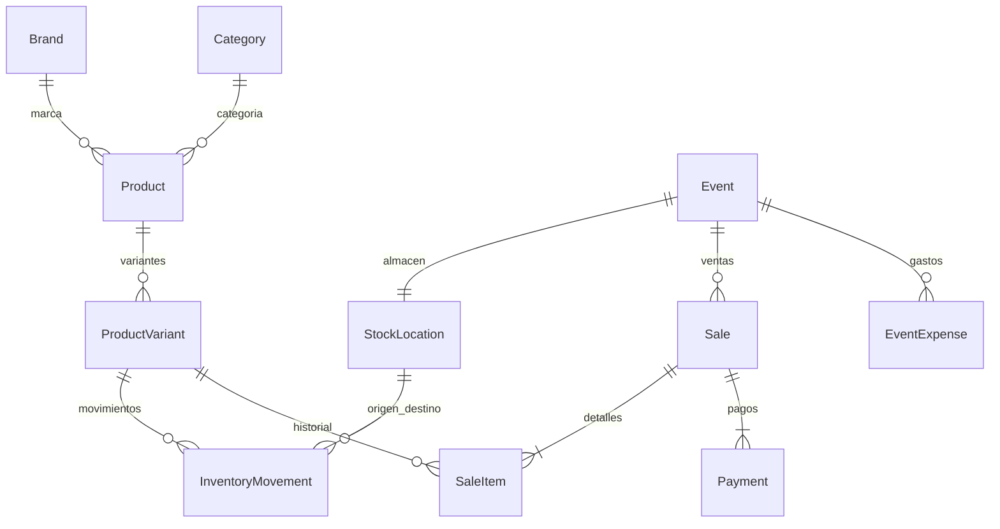

## Métodos privados por evento — 2026-11-07

Se retiran todas las cuentas precargadas. Configuración explícita por evento: efectivo siempre y BAC/Ficohsa/Atlántida/Kash opcionales con cuenta/usuario y titular obligatorios al habilitar. Primer ingreso sin eventos abre diálogo; permite continuar para restaurar respaldo. Se exige configurar antes de abrir evento o cobrar en él. Eventos existentes conservados. Bóveda separada IndexedDB AES-GCM con clave no exportable del dispositivo, IV aleatorio y eventId autenticado. No se incluye en JSON ni en Git ni se sincroniza: hay que reingresar cuentas en otro navegador. El cifrado en reposo no protege frente a alguien con acceso al navegador desbloqueado.

## Ajuste sencillo de mercadería y cuentas — 2026-11-07

Descripciones opcionales por pieza en carrito de mercadería (cantidad × packUnits, individual=1), sugerencias nativas desde ventas locales guardadas, historial y respaldo. Campo SaleItem.pieceDescriptions opcional: sin migración ni cambios de stock. BAC, Ficohsa, Atlántida y Kash muestran cuenta y copiar; Ficohsa/Atlántida conservan método interno Otro y nombre en referencia. Sin QR ni dependencias nuevas.

## v1.1.1: fotos y catálogo distribuido

Payment.evidence opcional contiene dataUrl JPEG (máximo 1,400,000 caracteres), width y height (máximo 1600 px). Forma parte del pago y de la transacción de checkout. AppSettings.catalogSeedVersion opcional identifica la semilla inicial. No se alteran índices/tablas: IndexedDB sigue v3. La aplicación es 1.1.1, el respaldo exportado es formato 3 (importa 1/2/3) y la semilla es 2026-11-07.1. Se eleva el límite de importación a 200 MB por los adjuntos. Ver DEPLOYMENT.md.

# Modelo de datos — refinamiento v1.1

IndexedDB **v3** agrega solamente la tabla inventoryCounts. La migración v2→v3 no reescribe ninguna fila existente. Los campos nuevos son opcionales: no hay actualización masiva de catálogo. Las versiones v1/v2 publicadas permanecen sin cambios; una instalación que aún esté en v1 ejecutará también su migración v2 preexistente.

| Entidad | Cambio |
| --- | --- |
| Product | grindOptions?: string[]. Nuevos cafés: Molido; Grano se habilita por operador. Ausente conserva el comportamiento previo Grano/Molido y opciones existentes de variante. |
| Sale | eventId opcional: ausencia significa Venta rápida. UUID y timestamp siempre presentes. |
| SaleItem | inventoryAllocations?: {locationId, quantity}[] para deducciones verificadas; inventoryStatus?: pending/resolved/cancelled; inventoryLocationId y reconciliationId para obligaciones. Snapshots de precio/costo/preparación siguen históricos. |
| InventoryCount | id, variantId, locationId, quantity (admite cero), mode beginning/current, pendingItemIds[], occurredAt. PK id; índices variantId/locationId. |
| EventExpense | voidedAt opcional y correctionHistory con fecha, motivo y valores previos. No se borran gastos. |

Respaldo JSON exporta **formato 2**; acepta formatos 1 y 2. Los respaldos antiguos sin inventoryCounts reciben una lista vacía en memoria antes de restaurar. AppSettings.schemaVersion sigue en 1 (su contrato no cambió). Versiones del motor, formato de respaldo y settings son independientes. Una versión anterior de la aplicación no puede importar el nuevo formato 2.

Los IDs de producto/variante y todos sus precios, movimientos, ventas, pagos y gastos se preservan en v2→v3. Nombres ambiguos como Molido/Grano no se normalizan automáticamente: «Revisar presentación» pide un nombre explícito y conserva ID, precio y saldo independiente. No se fusiona inventario.

Los orígenes se validan contra allocations en respaldos nuevos; los artículos antiguos sin allocations conservan la regla de origen en su evento. Obligaciones resueltas requieren referencias recíprocas al conteo. Una resolución por conteo actual no crea un descuento retrospectivo; si luego se anula la venta, sí se registra la devolución física a General.

Ver [guía de actualización y prueba](UX_REFINEMENT.md), [reglas](INVENTORY_RULES.md). La referencia original queda debajo como registro de la versión anterior.

---

# Modelo de datos — versión 1

Actualización del catálogo: IndexedDB usa versión **2**, manteniendo el formato de respaldo en **1** porque no cambian los campos persistidos. La migración v1→v2 actualiza Blended One a 250 g/L245 y desactiva la antigua presentación de 227 g sin borrar sus registros ni modificar movimientos o ventas. Solo se ejecuta una vez; posteriores ediciones se respetan.

El código es opcional en el formulario y en CatalogService. Si está vacío, se genera una referencia interna estable `AUTO-<UUID>` para conservar compatibilidad e índices únicos; no exige código comercial ni lector de barras. Grano/Molido son opciones de SaleItem sobre la misma variante: comparten stock y precio. El carrito permite ambas opciones en una venta.

Los contratos ejecutables están en `src/app/domain/models.ts`. Zod valida tanto entradas como respaldos. Todos los identificadores son UUID, fechas ISO UTC, dinero HNL en centavos enteros seguros y cantidades en unidades enteras positivas. La UI muestra fechas en America/Tegucigalpa. Los campos opcionales se omiten, nunca se inventan precios o costos.

| Entidad           | Campos y relaciones principales                                                                                                                                                                                                                  | Restricciones e índices                                                                            |
| ----------------- | ------------------------------------------------------------------------------------------------------------------------------------------------------------------------------------------------------------------------------------------------ | -------------------------------------------------------------------------------------------------- |
| Brand             | id, name, slug, description?, isActive, createdAt, updatedAt                                                                                                                                                                                     | PK id; slug único                                                                                  |
| Category          | id, name, sortOrder, isActive                                                                                                                                                                                                                    | PK id; nombre único                                                                                |
| Product           | id, brandId, categoryId, name, description, productType, imageUrl?, tags[], isActive, timestamps                                                                                                                                                 | FK marca/categoría; índices brandId, categoryId                                                    |
| ProductVariant    | id, productId, sku, name, weightValue?, weightUnit?, grindOption?, process?, priceMinor?, compareAtPriceMinor?, unitCostMinor?, trackInventory, lowStockThreshold?, isActive, sortOrder, packUnits?, timestamps                                  | SKU normalizado único; packUnits requiere unidades reales, precio de paquete explícito             |
| StockLocation     | id, name, type (general/event), eventId?, isActive, createdAt                                                                                                                                                                                    | Un almacén general; un almacén por evento                                                          |
| InventoryMovement | id, variantId, fromLocationId?, toLocationId?, quantity, type, eventId?, saleId?, referenceId?, note?, occurredAt, createdAt                                                                                                                     | Cantidad > 0; origen ≠ destino; saldo nunca negativo; índices variante, ubicaciones, evento, venta |
| Event             | id, name, venue?, city?, startsAt?, endsAt?, status, stockLocationId, openingCashMinor?, notes?, closedAt?, closingCashMinor?, timestamps                                                                                                        | draft → open → closed; ubicación recíproca                                                         |
| EventExpense      | id, eventId, category, description, amountMinor, paymentMethod?, incurredAt, createdAt                                                                                                                                                           | Importe > 0; evento abierto                                                                        |
| Sale              | id, eventId, receiptNumber, status, subtotalMinor, discountMinor, totalMinor, totalPaidMinor, changeMinor, notes?, soldAt, voidedAt?, voidReason?, refundStatus?, refundedAt?, createdAt                                                         | id = clave idempotente del cobro; recibo único; una venta completed o voided; pago manual          |
| SaleItem          | id, saleId, variantId, skuSnapshot, productNameSnapshot, variantNameSnapshot, brandNameSnapshot, categoryNameSnapshot, grindOptionSnapshot?, quantity, unitPriceMinor, unitCostMinor?, lineDiscountMinor, lineTotalMinor, trackInventorySnapshot | Snapshot inmutable; descuentos de venta distribuidos por centavos                                  |
| Payment           | id, saleId, method, amountMinor, receivedMinor?, changeMinor?, reference?, paidAt                                                                                                                                                                | cash/bac/kash/other; un pago en MVP; monto aplicado = total                                        |
| AppSettings       | id, businessName, currency, locale, timeZone, schemaVersion, deviceInstallId, lastBackupAt?, compactDisplay, backupReminderDays                                                                                                                  | Una fila; HNL/es-HN; versión 1                                                                     |

Las estructuras y enums exactos se validan con esquemas estrictos: propiedades desconocidas se rechazan en importación. Los campos de texto tienen límites; los importes admiten cero donde tiene sentido. No se permite borrar catálogo referenciado; desactivar conserva historia. Cambiar `trackInventory` después de movimientos está prohibido.

## Contabilidad de inventario

El saldo se reconstruye sumando movimientos entrantes menos salientes por variante y ubicación. Cada transferencia es un movimiento con ambas ubicaciones. No existe tabla de saldos duplicada. initial_stock/restock/adjustment_in entran; sale/sample/waste/adjustment_out salen; las devoluciones y reversas nunca reescriben movimientos previos. Las bebidas no controlan inventario inicialmente; paquetes y stickers son SKU independientes.

## Transacciones y restauración

El repositorio ejecuta lectura, validación y escritura en una transacción readwrite de IndexedDB sobre todas las tablas. Serializa comandos incluso entre pestañas. Los servicios trabajan contra un contrato de repositorio, sin Dexie en componentes. Para el tamaño del MVP se carga el estado completo; escalar a consultas y unidades de trabajo selectivas cuando los volúmenes lo requieran.

El cierre exige conteo de todas las variantes con saldo. Las diferencias generan ajustes motivados y luego devoluciones; toda la operación es atómica. Un evento cerrado no admite nuevas operaciones ni anulaciones: un caso posterior necesita un procedimiento de corrección futuro. Las anulaciones abiertas restauran solo artículos que descontaron stock y registran estado de reembolso pendiente o realizado.

Un respaldo incluye todas las tablas, schemaVersion, appVersion, exportedAt y deviceInstallId. Antes de reemplazar se validan relaciones, unicidad, importes, estados, saldos e integridad de ventas. Reemplazo atómico y confirmación explícita. No hay mezcla automática de respaldos.

